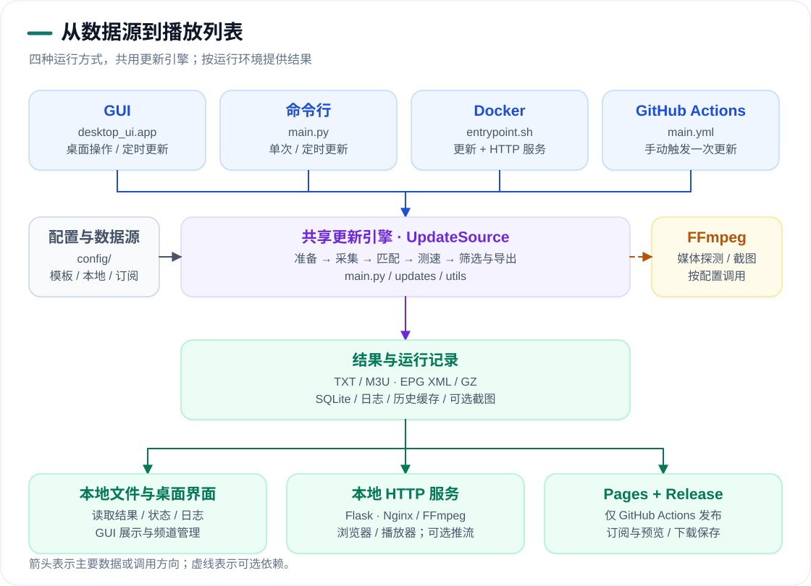
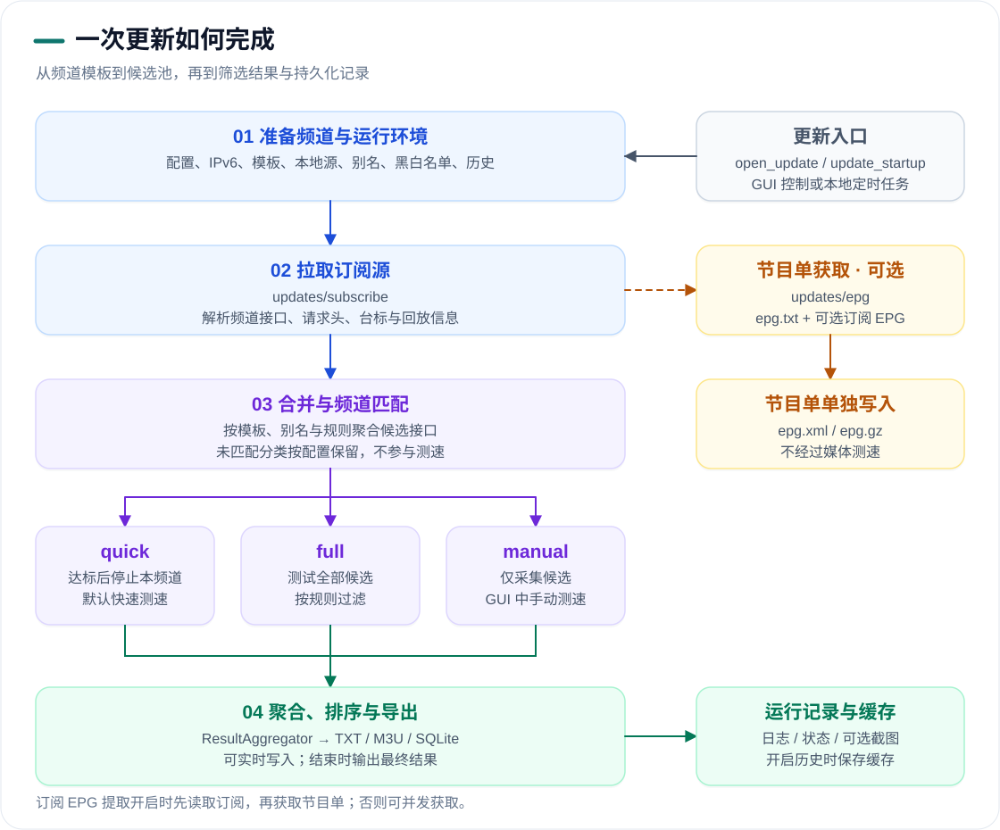
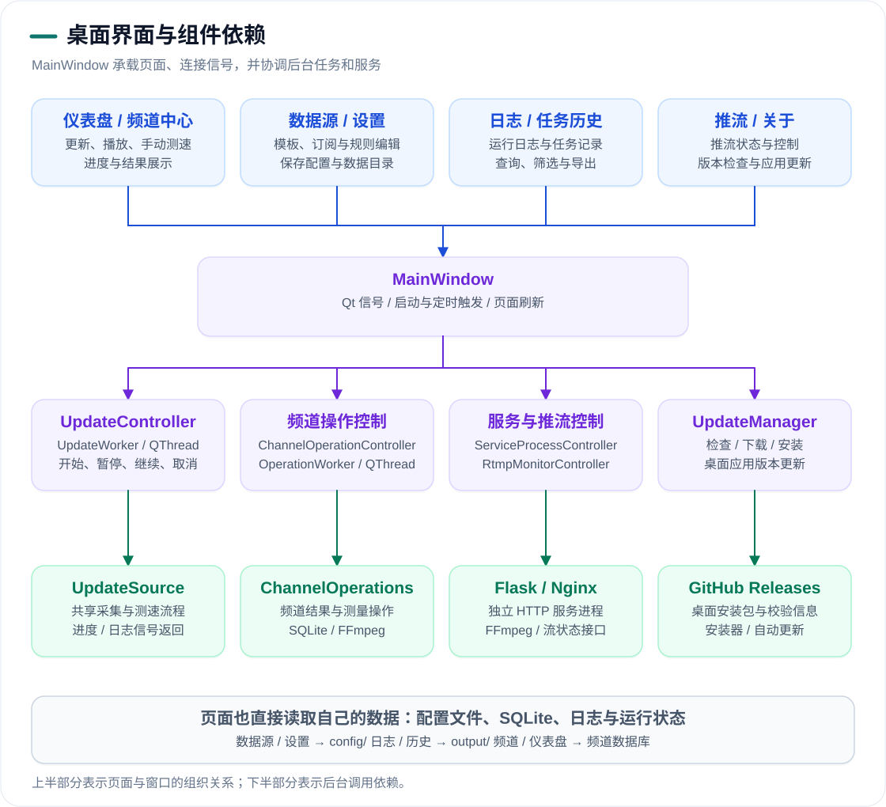

# 架构与运行流程

  <a href="../README.md">项目首页</a> ·
  <a href="./README.md">文档中心</a> ·
  <a href="./tutorial.md">使用教程</a> ·
  中文 | <a href="./architecture_en.md">English</a>

## 整体架构

GUI、命令行、Docker 和 GitHub Actions 共用 `main.py` 中的 `UpdateSource`。部署方式决定如何触发更新、是否运行本地服务，以及如何提供生成结果。

<picture>
  <source media="(prefers-color-scheme: dark)" srcset="./images/architecture/overview-zh-dark.svg">
  <source media="(prefers-color-scheme: light)" srcset="./images/architecture/overview-zh.svg">
  
</picture>

| 层次 | 主要组件 | 职责 |
|:---|:---|:---|
| 运行入口 | [desktop_ui/app.py](../desktop_ui/app.py)、[main.py](../main.py)、[entrypoint.sh](../entrypoint.sh)、[main.yml](../.github/workflows/main.yml) | 初始化运行环境，启动桌面、更新任务或容器服务；Actions 手动执行一次更新 |
| 更新引擎 | [UpdateSource](../main.py)、[updates/subscribe](../updates/subscribe/)、[updates/epg](../updates/epg/) | 准备频道、抓取订阅与 EPG、匹配候选接口、组织测速 |
| 结果处理 | [ResultAggregator](../utils/aggregator.py)、[channel.py](../utils/channel.py)、[channel_repository.py](../utils/channel_repository.py) | 聚合、筛选、排序、导出播放列表，记录频道结果与任务信息 |
| 本地服务 | [service/app.py](../service/app.py)、[service/rtmp.py](../service/rtmp.py) | 提供结果页面、播放列表、EPG、台标与推流控制，按需调用 FFmpeg 和 Nginx |
| 工作流发布 | [publish_results.py](../scripts/publish_results.py)、[main.yml](../.github/workflows/main.yml) | 准备公开文件、发布每次运行的 Release、部署 Pages |

命令行的更新进程与服务进程分别通过 `pipenv run dev` 和 `pipenv run service` 启动。桌面端通过 `ServiceProcessController` 管理独立服务进程；Docker 入口同时启动 Nginx、更新进程与 Gunicorn/Flask。GitHub Actions 生成静态结果并发布到 Pages，不运行常驻的 Flask 或推流服务。

## 一次更新的流程

<picture>
  <source media="(prefers-color-scheme: dark)" srcset="./images/architecture/pipeline-zh-dark.svg">
  <source media="(prefers-color-scheme: light)" srcset="./images/architecture/pipeline-zh.svg">
  
</picture>

1. 读取有效配置，检查 IPv6，按模板准备本地接口、别名、黑白名单及启用的历史数据。模板没有频道时记录空结果诊断并结束。
2. 抓取订阅源，解析频道及附带信息。EPG 按配置独立获取并生成 `epg.xml` / `epg.gz`；开启 `open_subscribe_epg` 时，先从订阅中提取 EPG 地址，再获取节目单，否则订阅与 EPG 可并发获取。
3. 按模板和别名合并候选接口，应用相关规则。开启未匹配分类时，该分类直接进入输出，不参与测速。
4. `quick` 达到频道目标后停止剩余测速；`full` 测试全部候选；`manual` 仅刷新候选池，后续在 GUI 手动测速，不将采集结果当作已测量结果。
5. `ResultAggregator` 聚合并导出结果，可在测速期间增量写入，结束时完成最终输出。SQLite 保存频道结果和任务记录；日志、运行状态和可选截图单独保存。开启历史后，保存缓存和冻结状态供后续更新使用。

TXT 为基础输出，M3U、EPG、截图和历史缓存按配置及实际结果生成。各阶段的开关与筛选设置见[配置参数](./config.md)。

## 桌面页面与组件依赖

<picture>
  <source media="(prefers-color-scheme: dark)" srcset="./images/architecture/gui-zh-dark.svg">
  <source media="(prefers-color-scheme: light)" srcset="./images/architecture/gui-zh.svg">
  
</picture>

页面由 `MainWindow` 组织，用户操作通过 Qt 信号连接后台控制器；进度、日志和服务状态再通过信号更新界面。页面同时直接读取各自的数据文件和数据库。

| 页面 | 主要依赖 | 数据或操作 |
|:---|:---|:---|
| 仪表盘 | `UpdateController`、频道数据库、运行状态、推流监控 | 更新控制、进度、频道与服务概况、定时触发 |
| 频道中心 | `ChannelOperationController` → `ChannelOperations`、频道数据库、播放组件 | 重新测速、截图、台标、播放与推流控制 |
| 数据源 | `config/` 中的模板、本地源、订阅、EPG、别名与黑白名单 | 编辑输入文件，供更新引擎读取 |
| 设置 | `utils.config.Config`、个人配置、桌面运行目录设置 | 保存配置覆盖和数据目录选择 |
| 日志 | `output/log/`、`run_state.json` | 读取、筛选和导出运行日志 |
| 任务历史 | `channel_repository` 与 SQLite | 查询更新任务、频道操作和结果记录 |
| 推流 | `RtmpMonitorController`、Flask 控制接口、Nginx 统计 | 监控状态、开始或停止频道流 |
| 关于 | `UpdateManager`、GitHub Releases、桌面安装器 | 检查、下载和安装桌面应用更新 |

`UpdateController` 的 `UpdateWorker` 在 `QThread` 中调用 `UpdateSource.run_once()`；频道手动操作通过另一个工作线程和操作队列执行。关于页面更新的是桌面安装包，与 Actions 发布的播放列表 Release 是两条独立链路。

## 部署与播放链路

| 需要了解的关系 | 图表位置 |
|:---|:---|
| 配置覆盖顺序及各阶段使用的参数 | [配置如何影响运行流程](./config.md#配置如何影响运行流程) |
| 结果生成、Release 发布和 Pages 部署顺序 | [工作流生成与发布流程](./tutorial.md#工作流生成与发布流程) |
| 播放请求、Flask、FFmpeg、RTMP 与 HLS 的依赖 | [推流请求与媒体链路](./tutorial.md#推流请求与媒体链路) |
