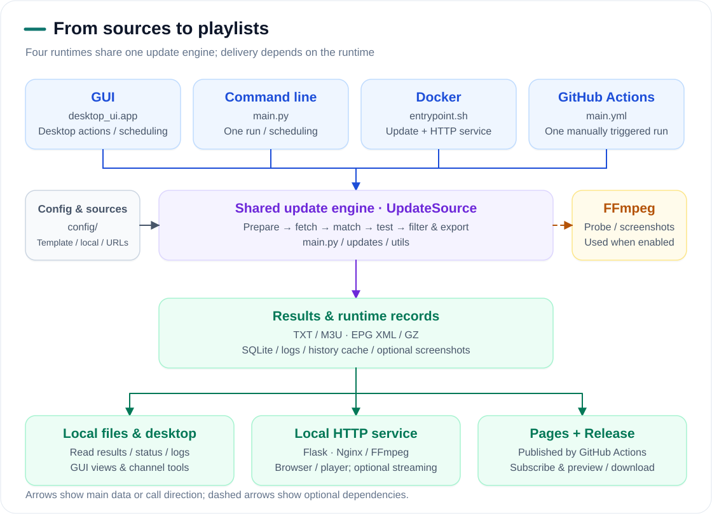
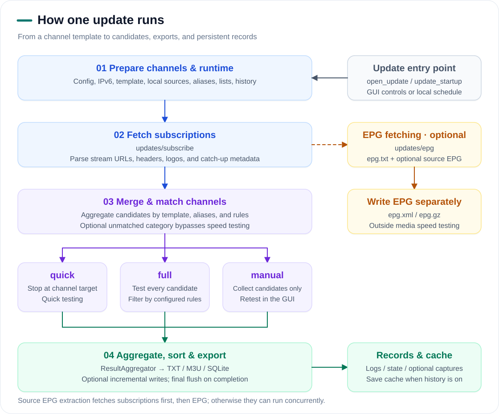
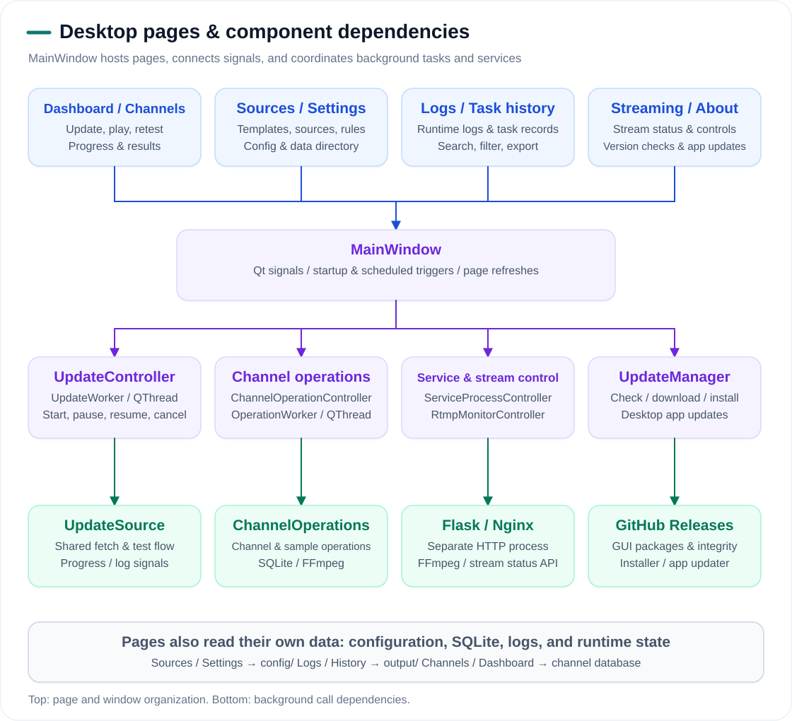

# Architecture and Runtime Flow

  <a href="../README_en.md">Project home</a> ·
  <a href="./README.md">Documentation</a> ·
  <a href="./tutorial_en.md">Tutorial</a> ·
  <a href="./architecture.md">中文</a> | English

## System overview

The GUI, command line, Docker, and GitHub Actions share `UpdateSource` in `main.py`. The runtime determines how updates are triggered, whether a local service runs, and how results are delivered.

<picture>
  <source media="(prefers-color-scheme: dark)" srcset="./images/architecture/overview-en-dark.svg">
  <source media="(prefers-color-scheme: light)" srcset="./images/architecture/overview-en.svg">
  
</picture>

| Layer | Main components | Responsibility |
|:---|:---|:---|
| Entry points | [desktop_ui/app.py](../desktop_ui/app.py), [main.py](../main.py), [entrypoint.sh](../entrypoint.sh), [main.yml](../.github/workflows/main.yml) | Initialize the runtime and start the desktop, update task, or container services; Actions manually runs one update |
| Update engine | [UpdateSource](../main.py), [updates/subscribe](../updates/subscribe/), [updates/epg](../updates/epg/) | Prepare channels, fetch subscriptions and EPG, match candidates, and coordinate testing |
| Result processing | [ResultAggregator](../utils/aggregator.py), [channel.py](../utils/channel.py), [channel_repository.py](../utils/channel_repository.py) | Aggregate, filter, sort, and export playlists; record results and tasks |
| Local service | [service/app.py](../service/app.py), [service/rtmp.py](../service/rtmp.py) | Serve result pages, playlists, EPG, logos, and stream controls; invoke FFmpeg and Nginx when needed |
| Workflow publication | [publish_results.py](../scripts/publish_results.py), [main.yml](../.github/workflows/main.yml) | Prepare public files, publish a Release for each run, and deploy Pages |

The command-line update and service processes start separately with `pipenv run dev` and `pipenv run service`. The desktop manages a separate service process through `ServiceProcessController`. Docker starts Nginx, the update process, and Gunicorn/Flask together. GitHub Actions publishes static results to Pages without a persistent Flask or streaming service.

## One update run

<picture>
  <source media="(prefers-color-scheme: dark)" srcset="./images/architecture/pipeline-en-dark.svg">
  <source media="(prefers-color-scheme: light)" srcset="./images/architecture/pipeline-en.svg">
  
</picture>

1. Load configuration, check IPv6, and prepare channels from the template, local sources, aliases, allow/block lists, and enabled history. An empty channel template ends with an empty-result diagnostic.
2. Fetch subscriptions and parse channels and metadata. EPG is fetched separately when enabled and written to `epg.xml` / `epg.gz`. With `open_subscribe_epg` enabled, subscriptions are fetched first to discover EPG URLs; otherwise subscriptions and EPG can be fetched concurrently.
3. Merge candidates by template and aliases and apply the relevant rules. An enabled unmatched category goes directly to output without speed testing.
4. `quick` stops remaining tests when a channel reaches its target; `full` tests all candidates; `manual` refreshes candidates for later GUI retesting and does not mark collected candidates as measured.
5. `ResultAggregator` aggregates and exports results, optionally writing incremental results during testing and flushing final output on completion. SQLite stores channel results and tasks. Logs, runtime state, and optional screenshots are stored separately. Enabled history saves cache and frozen state for later runs.

TXT is the base output. M3U, EPG, screenshots, and history cache depend on configuration and available results. Stage switches and filters are listed in the [configuration reference](./config_en.md).

## Desktop pages and dependencies

<picture>
  <source media="(prefers-color-scheme: dark)" srcset="./images/architecture/gui-en-dark.svg">
  <source media="(prefers-color-scheme: light)" srcset="./images/architecture/gui-en.svg">
  
</picture>

`MainWindow` hosts pages and connects actions to background controllers through Qt signals. Progress, logs, and service state return through signals to update the UI. Pages also read their own files and databases directly.

| Page | Main dependencies | Data or actions |
|:---|:---|:---|
| Dashboard | `UpdateController`, channel database, runtime state, stream monitor | Update controls, progress, summaries, and scheduled triggers |
| Channel center | `ChannelOperationController` → `ChannelOperations`, channel database, playback components | Retest, screenshots, logos, playback, and stream controls |
| Sources | Templates, local sources, subscriptions, EPG, aliases, and allow/block lists under `config/` | Edit input files consumed by the update engine |
| Settings | `utils.config.Config`, personal configuration, desktop directory settings | Save overrides and data-directory choices |
| Logs | `output/log/`, `run_state.json` | Read, filter, and export logs |
| Task history | `channel_repository` and SQLite | Query update runs, operations, and result records |
| Streaming | `RtmpMonitorController`, Flask control endpoints, Nginx statistics | Monitor, start, and stop channel streams |
| About | `UpdateManager`, GitHub Releases, desktop installer | Check, download, and install app updates |

`UpdateController` runs `UpdateWorker`, which calls `UpdateSource.run_once()` inside a `QThread`. Manual channel actions use another worker thread and queue. About updates the desktop package; playlist Releases published by Actions are a separate flow.

## Deployment and playback paths

| Relationship | Diagram location |
|:---|:---|
| Configuration precedence and stage settings | [How configuration shapes a run](./config_en.md#how-configuration-shapes-a-run) |
| Generation, Release publication, and Pages deployment order | [Workflow generation and publication](./tutorial_en.md#workflow-generation-and-publication) |
| Playback requests, Flask, FFmpeg, RTMP, and HLS | [Streaming requests and media flow](./tutorial_en.md#streaming-requests-and-media-flow) |
